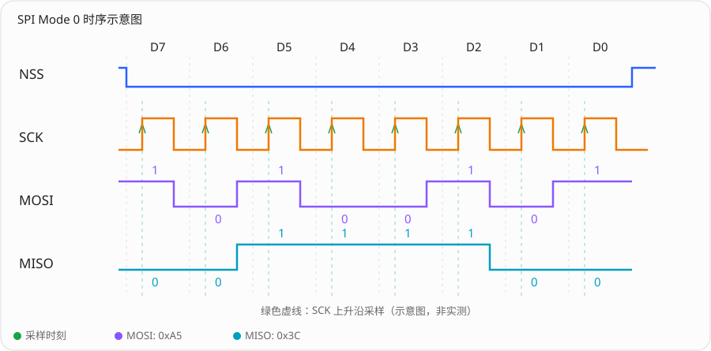

# STM32F103 选型 + SPI.

## 1. 项目使用的型号

Mcu.CPN=STM32F103CBT6
Mcu.Package=LQFP48

型号可拆分理解：

| 字段 | 含义 |
| --- | --- |
| STM32 | ST 的 32 位微控制器系列 |
| F103 | STM32F1 中的 F103 产品线，使用 Cortex-M3 内核 |
| C | 48 引脚 |
| B | 128 KiB Flash 容量等级 |
| T | LQFP 封装 |
| 6 | 工业温度等级：−40～+85 ℃ |

CBT6 的基本规格为 72 MHz Cortex-M3、128 KiB Flash、20 KiB SRAM、LQFP48，工作电源范围为 2.0～3.6 V。

## 2. 外设组成

| 参数 | STM32F103CBT6 | GD32F103CBT6 |
| --- | --- | --- |
| 最高主频 | 72 MHz | 108 MHz |
| Flash | 128 KB | 128 KB |
| SRAM | 20 KB | 20 KB |
| 封装 | LQFP48 | LQFP48 |
| 引脚数量 | 48 | 48 |
| GPIO | 最多 37 个 | 最多 37 个 |
| USART | 3 路 | 3 路 |
| SPI | 2 路 | 2 路 |
| I²C | 2 路 | 2 路 |
| CAN | 1 路 | 1 路 |
| USB | USB 2.0 FS | USB 2.0 FS Device |
| ADC | 2 个 12 位 ADC | 2 个 12 位 ADC |
| ADC 外部通道 | 10 路 | 10 路 |
| 通用定时器 | 3 个 16 位 | 3 个 16 位 |
| 高级定时器 | 1 个 16 位 | 1 个 16 位 |
| DMA | 1 个控制器，7 通道 | 1 个控制器，7 通道 |
| 看门狗 | 独立 + 窗口 | 独立 + 窗口 |
| RTC | 支持 | 支持 |
| 调试接口 | SWD / JTAG | SWD / JTAG |
| 工作电压 | 2.0～3.6 V | 2.6～3.6 V |
| 工作温度 | -40～85 ℃ | -40～85 ℃ |

## 3. 项目时钟配置

```text
外部 HSE 8 MHz
    ↓ 预分频 /1
PLL ×9 = 72 MHz
    ↓
SYSCLK = 72 MHz
    ↓ AHB /1
HCLK = 72 MHz
    ├─ APB1 /2 → PCLK1 = 36 MHz → USART2、I2C1
    └─ APB2 /1 → PCLK2 = 72 MHz → SPI1、GPIO、AFIO
```

| 配置 | 当前值 | 作用 |
| --- | --- | --- |
| HSE | 外部晶振模式，软件声明 8 MHz | PLL 的输入时钟 |
| PLL | HSE ×9 | 产生 72 MHz 系统时钟 |
| AHB | 不分频 | 内核和主要系统总线使用 72 MHz |
| APB1 | 2 分频 | USART2、I2C1 的总线时钟为 36 MHz |
| APB2 | 不分频 | SPI1 的总线时钟为 72 MHz |
| Flash 等待周期 | `FLASH_LATENCY_2` | 配合当前系统时钟访问 Flash |
| HSI、LSI | 初始化代码开启 | 内部时钟源；开启 LSI 不等于已启用看门狗 |

外设的总线时钟不是其通信速率。例如 SPI1 的输入时钟是 72 MHz，但通过分频才得到 2.25 MHz 或 18 MHz 的 SCK；USART2 的 36 MHz 输入时钟经过波特率配置后才形成 115200 bit/s。

## 3. 项目实际使用的外设
| 外设/资源 | 项目配置 | 主要用途 |
| --- | --- | --- |
| SPI1 | 主机、8 位、Mode 0、MSB first、软件片选 | 与 DW1000 通信 |
| USART2 | 115200、8N1、双向、无硬件流控 | 命令接收和结果输出 |
| DMA1 Channel6 | USART2 RX，普通模式，高优先级 | 串口接收搬运 |
| DMA1 Channel7 | USART2 TX，普通模式，很高优先级 | 业务数据发送 |
| I2C1 | 7 位地址；初始 400 kHz，部分 IMU 路径改为 100 kHz | EEPROM、IMU、电量计及部分板型 OLED |
| EXTI5 | PB5 上升沿中断 | DW1000 IRQ |
| GPIO | 输入、推挽输出、开漏输出等 | 拨码、LED、片选、复位、使能 |
| SysTick | HAL 系统节拍 | `HAL_GetTick()`、延时等时间基础 |
| SWD | 保留 SWD，关闭 JTAG | 下载和调试，同时释放部分复用引脚 |
| IWDG | 有初始化代码，主函数调用被注释 | 当前启动路径未启用 |

## 4. 项目选择 STM32F103CBT6

### 4.1 接口资源与系统需求匹配

本项目需要一组 SPI 访问 DW1000、一组串口与上位机通信、一组 I2C 接传感器和 EEPROM，还需要外部中断、DMA、拨码和 LED 引脚。

DMA 接收/发送降低了串口逐字节搬运的 CPU 负担，EXTI 支持 DW1000 事件响应，SWD 保留了调试通道。

### 4.2 CB 的 128 KiB Flash 有明确的容量依据


```text
Total RO  Size = 98368 bytes(Read Only)代码和只读常量占用的空间Flash
Total RW  Size =  8600 bytes(Read Write)已初始化变量和零初始化变量等占用的空间RAM
Total ROM Size = 98572 bytes(Read Only Memory)程序实际需要的 ROM 存储空间Flash
```

| 资源 | 已有构建记录 | 芯片容量 | 静态占比 |
| --- | --- | --- | --- |
| Flash / ROM | 98,572 字节，约 96.26 KiB | 128 KiB | 约 75.2% |
| RW + ZI | 8,600 字节，约 8.40 KiB | 20 KiB SRAM | 约 42.0% |

**这份固件的 ROM 大小已经超过 64 KiB，因此不能按 F103C8 的标称 64 KiB Flash 容量来承载该构建。** CB 提供的 128 KiB 对 DW1000 驱动、HAL、业务协议与传感器代码有实际价值。

## 5. SPI1 连接 DW1000

### 5.1 引脚与工作模式

HAL_SPI_MspInit()

| 信号 | STM32 引脚 | 初始 GPIO 模式 | 上下拉与输出速度 | 初始电平 / 作用 |
| --- | --- | --- | --- | --- |
| NSS/CS | PA4 | 通用推挽输出 `GPIO_MODE_OUTPUT_PP` | 无上下拉 `GPIO_NOPULL`；高速 `GPIO_SPEED_FREQ_HIGH` | 初始输出高电平，不选中；软件拉低后选中 DW1000 |
| SCK | PA5 | 复用推挽输出 `GPIO_MODE_AF_PP` | `Pull` 字段保持零初始化值（`GPIO_NOPULL`）；高速 `GPIO_SPEED_FREQ_HIGH` | 由 SPI1 输出时钟，Mode 0 的时钟空闲电平为低 |
| MISO | PA6 | 输入 `GPIO_MODE_INPUT` | 上拉 `GPIO_PULLUP`；输入模式不设置输出速度 | DW1000 → STM32，由 DW1000 驱动数据；未被驱动时由上拉提供默认高电平 |
| MOSI | PA7 | 复用推挽输出 `GPIO_MODE_AF_PP` | `Pull` 字段保持零初始化值（`GPIO_NOPULL`）；高速 `GPIO_SPEED_FREQ_HIGH` | STM32 → DW1000，由 SPI1 输出数据；源码未单独预置 GPIO 输出电平 |
| IRQ | PB5 | 上升沿外部中断 `GPIO_MODE_IT_RISING` | 下拉 `GPIO_PULLDOWN`；输入模式不设置输出速度 | DW1000 事件通知，连接 EXTI5；未被驱动时由下拉提供默认低电平 |
| RSTn | PA0 | 通用开漏输出 `GPIO_MODE_OUTPUT_OD` | 无上下拉 `GPIO_NOPULL`；初始低速 `GPIO_SPEED_FREQ_LOW` | `MX_GPIO_Init()` 初始输出低电平，使复位有效；随后释放，见下文 |

`MX_SPI1_Init()` 的关键配置：

```c
hspi1.Instance = SPI1;
hspi1.Init.Mode = SPI_MODE_MASTER;
hspi1.Init.Direction = SPI_DIRECTION_2LINES;
hspi1.Init.DataSize = SPI_DATASIZE_8BIT;
hspi1.Init.CLKPolarity = SPI_POLARITY_LOW;
hspi1.Init.CLKPhase = SPI_PHASE_1EDGE;
hspi1.Init.NSS = SPI_NSS_SOFT;
hspi1.Init.BaudRatePrescaler = SPI_BAUDRATEPRESCALER_32;
hspi1.Init.FirstBit = SPI_FIRSTBIT_MSB;
```



NSS/CS 由软件拉低选中 DW1000；SCK 空闲为低，上升沿同时采样 MOSI/MISO，下降沿更新下一位数据，按 D7 → D0 传输。图中以 MOSI = 0xA5、MISO = 0x3C 为例；连续传输多个字节时，CS 在整个事务内保持低电平。初始化时 SCK = 72 MHz / 32 = 2.25 MHz。

即主机、双线全双工、8 位数据、MSB 优先、SPI Mode 0，片选由软件控制。SCK/MOSI 配置为复用推挽输出，MISO 为上拉输入。

### 5.2 初始化低速，正常工作高速

```c
port_set_dw1000_slowrate();  // SPI_BAUDRATEPRESCALER_32
port_set_dw1000_fastrate();  // SPI_BAUDRATEPRESCALER_4
```

结合本工程 8 MHz HSE、PLL ×9、APB2 不分频，SPI1 时钟源为 72 MHz：

- 低速：72 MHz / 32 = 2.25 MHz。
- 高速：72 MHz / 4 = 18 MHz。


## 6. SPI 底层读写过程

### 6.1 寄存器访问调用关系

```text
应用调用 dwt_* API
  → DW1000 驱动生成寄存器访问头
  → writetospi() / readfromspi()
  → SPI1 + GPIO 片选
  → DW1000 寄存器或数据缓冲区
```

访问头携带读写方向、寄存器及子地址等信息；后续数据段才是需要写入或读出的内容。应用层通常使用驱动 API，无需在状态机里手动拼 SPI 寄存器地址。

### 6.2 写操作

`writetospi()` 的核心操作：

```c
while (HAL_SPI_GetState(&hspi1) != HAL_SPI_STATE_READY) {}
HAL_GPIO_WritePin(DW_NSS_GPIO_Port, DW_NSS_Pin, GPIO_PIN_RESET);
HAL_SPI_Transmit(&hspi1, (uint8_t *)headerBuffer, headerLength, 10);
HAL_SPI_Transmit(&hspi1, (uint8_t *)bodyBuffer, bodyLength, 10);
HAL_GPIO_WritePin(DW_NSS_GPIO_Port, DW_NSS_Pin, GPIO_PIN_SET);
```

1.头部与数据在一次片选有效期间连续发送。当前是轮询阻塞发送，未使用 SPI DMA。
关闭中断保护：调用 decamutexon()，避免 SPI 传输过程被相关中断干扰。
2.等待 SPI 空闲：检查 HAL_SPI_GetState()，确保之前的 HAL 传输已完成。
3.拉低 CS 片选：选中 DW1000，开始一次 SPI 通信事务。
4.发送寄存器头部：通过 MOSI 发送 headerBuffer，告诉 DW1000要读取哪个寄存器或子地址。
5.读取寄存器数据：STM32 向 SPI 数据寄存器 DR 写入 0x00，产生 SCK 时钟，同时从 MISO 接收 DW1000 返回的数据。
6.结束 SPI 通信：拉高 CS，恢复之前的中断状态。

### 6.3 读操作

`readfromspi()` 先进入 `decamutexon()` 保护区，等待 SPI 就绪并拉低片选，逐字节发送访问头；之后直接操作 SPI 状态位和数据寄存器：

```c
while (__HAL_SPI_GET_FLAG(&hspi1, SPI_FLAG_TXE) == RESET) {}
hspi1.Instance->DR = 0;
while (__HAL_SPI_GET_FLAG(&hspi1, SPI_FLAG_RXNE) == RESET) {}
*readBuffer++ = hspi1.Instance->DR;
```

SPI 主机需要发送占位字节来产生读取时钟。读完后拉高片选，并调用 `decamutexoff(stat)` 恢复中断状态。

1.等待 SPI 空闲：调用 HAL_SPI_GetState()，确保 SPI 的 HAL 驱动处于就绪状态，避免与之前的传输发生冲突。
2.拉低 CS 片选：通过 HAL_GPIO_WritePin() 将 CS 拉低，选中 DW1000，开始一次 SPI 通信事务。
3.发送寄存器头部：调用 HAL_SPI_Transmit()，通过 MOSI 发送 headerBuffer，告诉 DW1000 要向哪个寄存器或子地址写入数据。
4.发送寄存器数据：再次调用 HAL_SPI_Transmit()，通过 MOSI 将 bodyBuffer 中的数据逐字节发送给 DW1000，SPI 硬件同步产生 SCK 时钟，DW1000 接收数据并写入指定寄存器。
5.结束 SPI 通信：通过 HAL_GPIO_WritePin() 将 CS 拉高，取消选中 DW1000，结束本次 SPI 写入事务。
