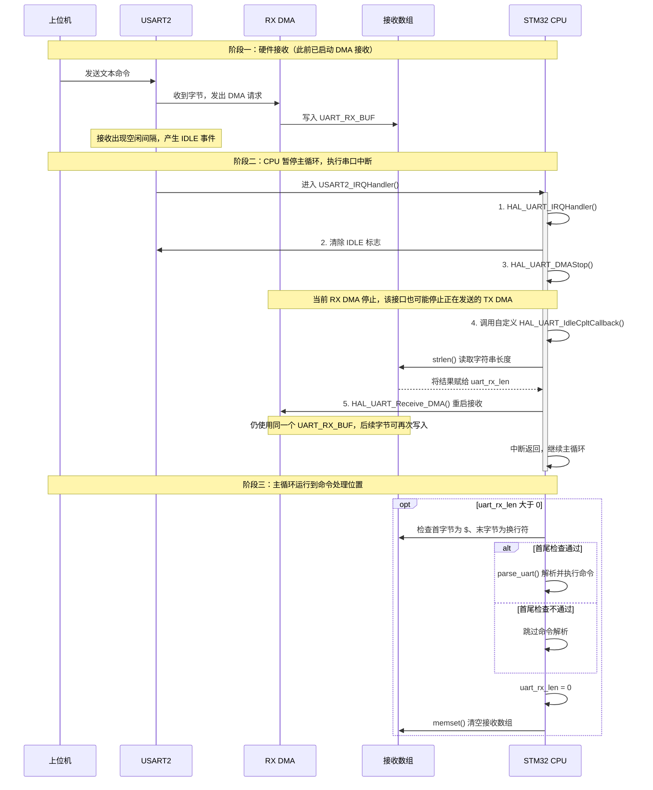

# UART DMA + IDLE 接收与发送

## 1. 在项目中负责什么

UART 是 STM32 与上位机之间的数据通道，主要承担两类工作：

- 接收上位机发送的文本命令，例如设置天线延时、设备地址、PAN ID、基站坐标等。
- 向上位机输出测距、定位、IMU 等数据，以及配置和命令应答。

接收路径采用 **DMA 搬运字节 + USART IDLE 中断通知 + 主循环解析命令**。发送路径中，测距等业务数据使用 DMA，配置打印、命令应答和 `printf` 仍有阻塞发送。


## 2. UART 与 DMA 的实际配置

### 3.1 USART2 配置

`MX_USART2_UART_Init()` 中配置如下：

```c
huart2.Instance = USART2;
huart2.Init.BaudRate = 115200;
huart2.Init.WordLength = UART_WORDLENGTH_8B; 
huart2.Init.StopBits = UART_STOPBITS_1;
huart2.Init.Parity = UART_PARITY_NONE;
huart2.Init.Mode = UART_MODE_TX_RX;
huart2.Init.HwFlowCtl = UART_HWCONTROL_NONE;
huart2.Init.OverSampling = UART_OVERSAMPLING_16;
```

即 **115200、8N1、无硬件流控、收发双向**。`HAL_UART_MspInit()` 配置 PA2 为 USART2_TX（复用推挽输出），PA3 为 USART2_RX（无上下拉输入），并开启 USART2 中断。

### 3.2 DMA 通道配置

```c
    hdma_usart2_rx.Instance = DMA1_Channel6;
    hdma_usart2_rx.Init.Direction = DMA_PERIPH_TO_MEMORY;
    hdma_usart2_rx.Init.PeriphInc = DMA_PINC_DISABLE;// 外设地址固定
    hdma_usart2_rx.Init.MemInc = DMA_MINC_ENABLE;// 内存地址递增
    hdma_usart2_rx.Init.PeriphDataAlignment = DMA_PDATAALIGN_BYTE;// 外设按字节传输
    hdma_usart2_rx.Init.MemDataAlignment = DMA_MDATAALIGN_BYTE;// 内存按字节传输
    hdma_usart2_rx.Init.Mode = DMA_NORMAL;// 普通模式
    hdma_usart2_rx.Init.Priority = DMA_PRIORITY_HIGH;// 高优先级
```

```c
    hdma_usart2_tx.Instance = DMA1_Channel7;
    hdma_usart2_tx.Init.Direction = DMA_MEMORY_TO_PERIPH;
    hdma_usart2_tx.Init.PeriphInc = DMA_PINC_DISABLE;
    hdma_usart2_tx.Init.MemInc = DMA_MINC_ENABLE;
    hdma_usart2_tx.Init.PeriphDataAlignment = DMA_PDATAALIGN_BYTE;
    hdma_usart2_tx.Init.MemDataAlignment = DMA_MDATAALIGN_BYTE;
    hdma_usart2_tx.Init.Mode = DMA_NORMAL;
    hdma_usart2_tx.Init.Priority = DMA_PRIORITY_VERY_HIGH;
```

外设地址不递增，是因为始终访问 USART 数据寄存器；内存地址递增，使接收字节依次存放在数组中，或让发送字节依次从数组取出。

```c
__HAL_LINKDMA(uartHandle, hdmarx, hdma_usart2_rx);
__HAL_LINKDMA(uartHandle, hdmatx, hdma_usart2_tx);
```

这两句建立 UART 与 DMA 句柄之间的关联，供 HAL 接收、发送及回调使用。

`MX_DMA_Init()` 开启 DMA1 时钟，并使能 Channel6、Channel7 中断。两个 DMA 中断与 USART2 中断均配置为 NVIC 优先级 `(0, 0)`。这里的 NVIC 优先级与表中的 DMA 仲裁优先级是不同概念。

**配置 DMA 并不等于启动接收。** 真正开始搬运数据，需要调用 `HAL_UART_Receive_DMA()`。

## 4. 接收启动流程

`main()` 中，相关初始化顺序为：

```text
MX_GPIO_Init()
  → MX_DMA_Init()
  → MX_USART2_UART_Init()
  → 其他外设及板级初始化
  → 开启 USART2 IDLE 中断
  → 启动 200 字节 DMA 接收
  → dw_main()
```

先开启 DMA1 时钟，再初始化 USART2 对应的 DMA 通道。

`dw_main.c` 定义接收数组和长度变量：

```c
uint8_t UART_RX_BUF[200];
uint32_t uart_rx_len;
```

`main.c` 中启动接收：

```c
__HAL_UART_ENABLE_IT(&huart2, UART_IT_IDLE);//开启UART_IT_IDLE
HAL_UART_Receive_DMA(&huart2, &UART_RX_BUF[0], sizeof(UART_RX_BUF));//开启接收
```

其中 `200` 是本次 DMA 接收容量，不是每条命令必须达到的长度。数据到来时，DMA 将 USART 接收到的字节写入数组，CPU 无需通过逐字节接收中断搬运数据。

由于使用普通模式，DMA 完成指定数量后不会自动循环；项目在 USART 中断处理中重新调用接收函数。

## 5. IDLE 与 DMA 如何配合

DMA 解决字节搬运问题，IDLE 用于发现接收过程中的空闲间隔。对于变长文本命令，不必等接满 200 字节才通知软件处理。

**空闲事件并不保证一条应用层命令完整。** 项目还会检查首字节 `$` 和末字节换行符 `\n`。同样，IDLE 本身不能自动解决命令拆包、粘包。

下面以一次短文本接收为例。图中的 CPU 是同一个 STM32 内核：进入串口中断时暂停主循环，中断返回后继续主循环。DMA 是独立的硬件，可以在 CPU 执行代码时搬运数据。



读图时注意：

- **空闲回调在中断里被直接调用**，只用 `strlen()` 更新长度；命令解析在主循环中进行。
- **DMA 在主循环解析之前就已重启**，不会等待解析完成。若新数据到来，可能覆盖主循环正在使用的同一个数组；图中的阶段划分并不表示 DMA 此时停止工作。
- 主循环发现长度大于 0 后，无论首尾检查是否通过，都会将长度清零并清空数组。
- 图中展示的是 IDLE 触发的路径。当前中断入口没有判断是否为 IDLE，发送完成等其他 USART2 中断也会执行这些自定义处理。

## 6. USART 中断与长度计算

### 6.1 项目中的中断处理

`stm32f1xx_it.c` 的核心代码：

```c
void USART2_IRQHandler(void)
{
    HAL_UART_IRQHandler(&huart2);

    __HAL_UART_CLEAR_IDLEFLAG(&huart2);
    HAL_UART_DMAStop(&huart2);
    HAL_UART_IdleCpltCallback(&huart2);
    HAL_UART_Receive_DMA(&huart2, &UART_RX_BUF[0], sizeof(UART_RX_BUF));
}
```

各步骤含义：

1. `HAL_UART_IRQHandler()` 处理 HAL 管理的 USART 中断事件。
2. `__HAL_UART_CLEAR_IDLEFLAG()` 清除空闲标志。本项目 STM32F1 HAL 宏通过依次读取 `SR`、`DR` 实现。
3. `HAL_UART_DMAStop()` 停止当前 UART DMA 传输。它并非只停止 RX，具体风险见后文。
4. 手动调用项目定义的 `HAL_UART_IdleCpltCallback()`，更新接收长度。
5. 重新以相同数组启动 DMA 接收。

`HAL_UART_IdleCpltCallback()` 是项目自行定义并调用的函数，不能仅凭名称把它当作 HAL 自动触发的标准空闲回调。

### 6.2 项目实际使用 strlen

```c
void HAL_UART_IdleCpltCallback(UART_HandleTypeDef *huart)
{
    uart_rx_len = strlen((char*)UART_RX_BUF);
}
```

此处读取的是 **C 字符串长度**，不是 DMA 实际搬运数量。它依赖接收数据后面仍然存在 `\0`：全局数组启动时为零，主循环处理后又会清空数组，因此短文本命令在没有并发覆盖时可能正常工作。

但 DMA 不会自动补字符串终止符。接满数组、接收含零字节的数据，或存在旧数据残留时，`strlen()` 就可能越界读取、提前截断或算出错误长度。

对于当前字节宽度的 DMA，更合适的计数关系为：

```c
/* 改进思路，当前项目回调未使用此写法 */
received_len = buffer_capacity - __HAL_DMA_GET_COUNTER(huart->hdmarx);
```

例如容量 200、剩余计数 184，则已收到 16 字节。改造时应在 RX DMA 已稳定停止且尚未重装计数器的阶段获取剩余数量，并核对停止接口是否保留计数。若后续要作为字符串解析，应复制到额外预留一个字节的缓冲区，再补 `\0`。

## 7. 主循环如何消费接收数据

命令处理位于 `dw_main()` 内部的业务循环中：

```c
if (uart_rx_len > 0)
{
    if ((UART_RX_BUF[0] == '$') &&
        (UART_RX_BUF[uart_rx_len - 1] == '\n'))
    {
        parse_uart(&UART_RX_BUF[0]);
    }
    uart_rx_len = 0;
    memset(UART_RX_BUF, 0, sizeof(UART_RX_BUF));
}
```

这里的设计意图是：中断只记录接收结果，主循环完成字符串处理、参数修改和命令执行，避免在中断里做较重的业务工作。

同时要注意，无论首尾检查是否通过，这段代码都会清空数组，因此未收到完整换行结尾的半条命令不会保留到下一次拼接。

`parse_uart()` 使用 `strcmp()`、`strchr()`、`strtok()`、`atoi()` 等解析命令，其中 `strtok()` 会修改输入数组。

| 命令示例 | 作用 |
| --- | --- |
| `$synctime,8640000\r\n` | 设置系统同步时间差 |
| `$santdly,16375\r\n` | 设置天线延时参数 |
| `$spanid,1\r\n` | 设置 PAN ID |
| `$stxpwr,1f1f1f1f\r\n` | 设置发射功率参数 |
| `$rantdly\r\n` | 查询天线延时 |
| `$rboot\r\n` | 重启设备 |

表中的 `\r\n` 表示实际回车、换行字节。外层检查只要求末尾 `\n`，但部分无参数命令在解析器里按包含 `\r\n` 的完整字符串匹配。

## 8. DMA 中断与发送链路

### 8.1 DMA 中断入口

```c
void DMA1_Channel6_IRQHandler(void)
{
    HAL_DMA_IRQHandler(&hdma_usart2_rx);
}

void DMA1_Channel7_IRQHandler(void)
{
    HAL_DMA_IRQHandler(&hdma_usart2_tx);
}
```

DMA 通道中断处理传输完成、半传输和错误等事件；USART IDLE 是串口自身的事件，经 `USART2_IRQHandler()` 处理。两者不能混为同一个中断。

### 8.2 业务数据使用 DMA 发送

`dw_main()` 将业务数据格式化到 `UART_TX_DATA[512]`，随后调用：

```c
HAL_UART_Transmit_DMA(&UART_PORT, &UART_TX_DATA[0], len);
len = 0;
```

DMA 发送是异步的。函数成功返回只代表已启动发送，不代表全部字节已发送到线路上；`len = 0` 也不等于发送完成。

本项目 HAL 在普通模式 DMA TX 完成后，关闭 UART DMA TX 请求并开启 UART `TC` 中断，随后由 USART 中断完成发送收尾。因此，USART2 中断入口不仅可能由 IDLE 触发，也可能由发送完成触发。

发送缓冲区必须在传输完成前保持有效且内容不变，连续启动发送时还需要处理 `HAL_BUSY` 等返回值。

### 8.3 并非所有发送都使用 DMA

`print_config()` 和多处命令应答调用 `HAL_UART_Transmit()`。`usart.c` 中的 `fputc()` 也使用该阻塞接口逐字节输出：

```c
int fputc(int ch, FILE *f)
{
    HAL_UART_Transmit(&UART_PORT, (uint8_t *)&ch, 1, 0xffff);
    return ch;
}
```

所以应准确描述为“业务数据使用 DMA 发送，同时存在阻塞打印与应答”。

## 9 补充知识

这些函数属于 C 标准库：`strcmp()`、`strchr()`、`strtok()` 在 `<string.h>` 中声明，`atoi()` 在 `<stdlib.h>` 中声明。

| 函数 | 作用 | 在项目中的用途 |
| --- | --- | --- |
| `strcmp(a, b)` | 比较两个以 `\0` 结尾的字符串，相等时返回 0 | 判断命令名是否匹配，例如 `$spanid` |
| `strchr(s, ',')` | 查找第一个逗号，找到时返回该字符的地址，找不到返回 `NULL` | 判断是否包含参数分隔符 |
| `strtok(s, ",")` | 按逗号分隔字符串，返回下一个非空字段的指针，并修改原数组 | 拆出命令名和参数 |
| `atoi(s)` | 将字符串开头的十进制数字转换为 `int` | 将参数 `"123"` 转成整数 `123` |

#### strcmp()：返回 0 才表示相等

```c
if (strcmp(retptr, "$spanid") == 0)
{
    // 命令名是 $spanid
}
```

`strcmp()` 比较的是字符串内容；`==` 直接比较两个字符串指针时，比较的是地址。`strcmp()` 不相等时返回负数或正数，不保证恰好是 -1 或 1，且区分大小写。

项目的无参数命令按完整字符串比较，例如 `strcmp((char *)data, "$rboot\r\n") == 0`。因此 `$rboot\n` 与 `$rboot\r\n` 不相等，即便两者都能通过主循环的末字节换行检查。

#### strchr()：查找分隔符的位置

```c
char *comma = strchr((char *)data, ',');
if (comma != NULL)
{
    // 找到了逗号，可以进一步拆分命令和参数
}
```

返回值是指针，不是字符的下标，也不是参数个数。若需要下标，可以在找到之后计算 `comma - (char *)data`。项目原代码写成 `strchr((char*)data, ',') > 0`；判断是否找到时，更规范的写法是与 `NULL` 作不等比较。找到逗号也不意味着参数一定有效。

#### strtok()：第一次传数组，后续传 NULL

以 `$spanid,123\r\n` 为例，下面是独立的教学示例，不是对固件的修改：

```c
char text[] = "$spanid,123\r\n";  // 可修改的数组，末尾自动带 \0

char *command = strtok(text, ","); // 指向 "$spanid"
char *argument = strtok(NULL, ","); // 指向 "123\r\n"

if (command != NULL && argument != NULL &&
    strcmp(command, "$spanid") == 0)
{
    int panid = atoi(argument);     // 得到 123
    // 此处仅演示转换；实际还要验证参数格式和取值范围
}
```

第一次传入 `text`，表示开始拆分这段字符串；后续传入 `NULL`，表示从上一次保存的位置继续查找。项目中的 `ptr = NULL; retptr = strtok(ptr, ",");` 就是这个意思。

第一次拆分会把逗号改成字符串结束符 `\0`：

```text
拆分前：$spanid,123\r\n\0
拆分后：$spanid\0123\r\n\0
         ↑        ↑
      command  argument
```

上图的 `\0` 表示一个零字节，后面的 `123` 是另外三个字符。两个指针都指向原数组内部，**没有生成独立的字符串副本**。因此在本项目里调用 `strtok()`，会直接修改传入的 `UART_RX_BUF`。

使用时还要注意：

- 没有后续字段时返回 `NULL`，必须检查后再传给 `strcmp()`、`atoi()` 等函数。
- 分隔符参数是字符集合。例如 `",\r\n"` 表示逗号、回车、换行都作为分隔符；项目这里仅使用 `","`，所以最后的参数仍可能包含 `\r\n`。
- 连续分隔符会被跳过。例如 `a,,b` 会得到 `a`、`b`，不会返回中间的空字段；它不适合直接检测缺失的空参数。
- 它保存内部解析位置，不应在两段字符串之间交错调用，或在中断中打断另一处正在进行的 `strtok()` 解析。

#### atoi()：完成转换，不负责严格校验

```c
atoi("123");       // 123
atoi("123\r\n");   // 123，遇到后面的非数字字符停止转换
atoi("123abc");    // 123，并不会报告尾部存在非法字符
atoi("abc");       // 0，无法和合法输入 "0" 区分
```

`atoi()` 可以跳过前导空白，并识别正负号；它按十进制转换，不适合直接解析 `1f1f1f1f` 这样的十六进制参数。项目的发射功率参数使用了 `sscanf()` 按十六进制解析。

`atoi()` 不提供可靠的错误报告机制，转换结果超出 `int` 可表示范围时行为未定义。因此，只在转换后检查数值范围，不能代替格式与溢出检查。需要严格校验时，可使用 `strtol()`，同时检查是否读到数字、结束指针、`ERANGE` 以及业务取值范围；对于命令末尾的 `\r\n`，应明确允许或先移除。

#### 与 DMA 接收配合时的前提

上述字符串操作要求输入是有效的、以 `\0` 结束的 C 字符串。**DMA 只搬运收到的字节，不会自动补 `\0`；把 `uint8_t *` 强制转换成 `char *` 也不会复制数据或补结束符。**

实际解析前，应获得准确长度，把数据保存到容量足够且预留一个结束字节的独立缓冲区，再写入 `buffer[len] = '\0'`。在解析期间，该缓冲区不能被 DMA 或下一次接收覆盖。否则 `strcmp()`、`strchr()` 可能读到变化中的内容，`strtok()` 也会与 DMA 同时修改数组。独立缓冲区还需要配套忙状态或队列，防止上一条命令尚未解析完就被下一条覆盖。
