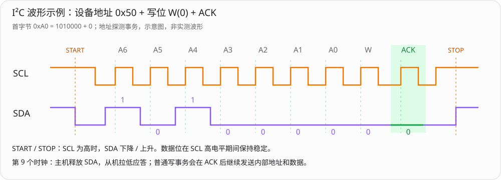
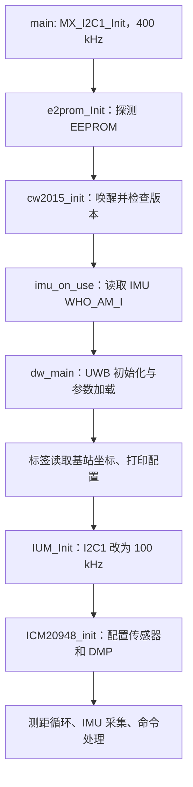
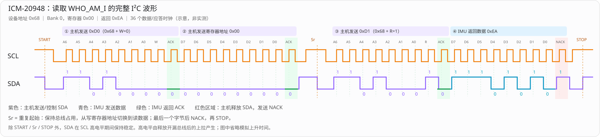
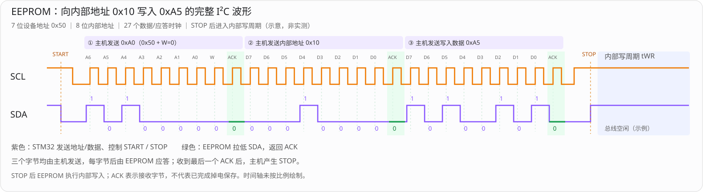
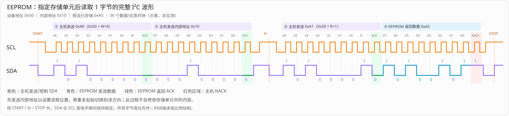

# I2C 接入 IMU、EEPROM 和 CW2015


## 1. 三类器件在项目中的职责

| 器件 | 项目职责 | 主要访问时机 |
| --- | --- | --- |
| ICM-20948 | 提供加速度、角速度、磁场和四元数，进一步计算姿态角 | 启动时探测和初始化，标签测距流程中读取 |
| 外部 EEPROM | 保存天线延时、发射功率、设备 ID、PAN ID、基站坐标等配置 | 启动时读取，收到配置命令时写入 |
| CW2015 | 提供电池剩余电量 SOC，供标签状态和测距消息使用 | 启动时唤醒和检查版本，标签测距流程中读取 |

三者在当前 STM32F103 路径中都使用 `hi2c1`，但上层处理方式不同：IMU 是寄存器/FIFO 驱动与传感器事件处理；EEPROM 是存储地址读写与参数序列化；CW2015 是电量计寄存器访问。

当前相关读写使用阻塞式 `HAL_I2C_Mem_Read()`、`HAL_I2C_Mem_Write()`，没有采用 I2C DMA。

## 2. I2C1 的硬件配置与地址

### 2.1 引脚和初始化

`HAL_I2C_MspInit()` 中配置：

```c
__HAL_RCC_GPIOB_CLK_ENABLE();
GPIO_InitStruct.Pin = GPIO_PIN_6 | GPIO_PIN_7;
GPIO_InitStruct.Mode = GPIO_MODE_AF_OD;
GPIO_InitStruct.Speed = GPIO_SPEED_FREQ_HIGH;
HAL_GPIO_Init(GPIOB, &GPIO_InitStruct);
__HAL_RCC_I2C1_CLK_ENABLE();
```

- PB6：I2C1_SCL。
- PB7：I2C1_SDA。
- GPIO 模式：复用开漏。

开漏总线需要合适的外部上拉。

`MX_I2C1_Init()` 的主要参数：

```c
hi2c1.Instance = I2C1;
hi2c1.Init.ClockSpeed = 400000;//400 kHz
hi2c1.Init.DutyCycle = I2C_DUTYCYCLE_2;//时钟占空比
hi2c1.Init.OwnAddress1 = 0;//I2C 从机地址
hi2c1.Init.AddressingMode = I2C_ADDRESSINGMODE_7BIT;//寻址方式为 7 位地址
hi2c1.Init.DualAddressMode = I2C_DUALADDRESS_DISABLE;//禁用双地址模式
hi2c1.Init.GeneralCallMode = I2C_GENERALCALL_DISABLE;//禁用 I2C 广播呼叫功能
hi2c1.Init.NoStretchMode = I2C_NOSTRETCH_DISABLE;//禁止 STM32 从机使用时钟拉伸
```

### 2.2 总线速率会改变

启动时使用 400 kHz；随后 `IUM_Init()` 会反初始化同一个 I2C1，并调用 `MX_I2C1_Init_Icm20948()`，将 `ClockSpeed` 设置为 100000。

因此不能笼统写成“本项目 I2C 始终工作在 400 kHz”。当前启用 IMU 的路径中，后续 EEPROM、CW2015 等共享设备的访问也使用重配置后的 100 kHz。源码可以证明发生了降速，不能据此认定 ICM-20948 硬件只能支持 100 kHz。

### 2.3 区分设备地址和内部地址

| 对象 | 7 位设备地址 | 传给 HAL 的设备地址 | 内部地址 |
| --- | --- | --- | --- |
| ICM-20948 | 当前使用 `0x68` | `0x68 << 1`，即 `0xD0` | 8 位寄存器地址，寄存器 bank 等细节由驱动管理 |
| 外部 EEPROM | `0x50` | `ADDR_24C02 = 0xA0` | 8 位存储单元地址 |
| CW2015 | `0x62` | `CW2015_ADDR = 0xC4` | 8 位寄存器地址 |


这里的 `I2C_MEMADD_SIZE_8BIT` 表示设备内部地址的宽度，与 I2C 总线采用 7 位设备寻址不是一回事。

### 2.4 I²C 波形示例



图中以 EEPROM 的 **7 位设备地址 `0x50`** 为例，展示 `START → 设备地址 + W(0) → ACK → STOP` 的地址探测事务：

- **地址与方向**：`0x50` 的 7 位地址为 `1010000`，附加写位 `0` 后，总线上发送的首字节为 `0xA0`，按高位到低位传输。
- **应答**：前 8 个时钟由主机发送地址和方向；第 9 个时钟主机释放 SDA，由从机拉低返回 ACK，图中用绿色标出。
- **电平变化**：除 START 和 STOP 外，SDA 在 SCL 高电平期间保持稳定，在低电平期间更新。开漏信号的高电平由释放总线后的上拉产生。

普通 EEPROM 写事务会在地址 ACK 后继续发送内部地址和数据，每个字节后都有一个应答时钟，最后产生 STOP。图中仅展示地址探测，不包含内部地址和数据字节；波形未按比例绘制，省略上升时间。

## 3. 启动顺序



`main()` 中记录探测结果：

```c
USE_EXT_EEPROM = e2prom_Init();
USE_CW2015 = cw2015_init();
#if defined(USE_IMUIC)
USE_IMU = imu_on_use();
#endif
```

`USE_EXT_EEPROM` 成功时为 `1`；`USE_CW2015` 在读取的版本等于 `0x73` 时为 `1`，否则为 `0`；`USE_IMU` 在探测符合预期时为 `9`，失败为 `0`。`USE_IMU` 的实际返回约定不是普通的 0/1 布尔值。

## 4. IMU 接入：从 HAL 到传感器数据

### 4.1 HAL 读写适配

驱动通过函数指针调用 STM32 I2C：

```c
int idd_io_hal_read_reg(void *context, uint8_t reg,
                        uint8_t *rbuffer, uint32_t rlen)
{
    (void)context;
    HAL_I2C_Mem_Read(&ICM20948_I2C, ICM_I2C_ADDR_REVA << 1,
                     reg, I2C_MEMADD_SIZE_8BIT,
                     rbuffer, rlen, HAL_MAX_DELAY);
    return 0;
}
```

写函数对应调用 `HAL_I2C_Mem_Write()`。`ICM20948_I2C` 宏为 `hi2c1`，`interface_is_SPI()` 返回 `false`。

适配层让芯片驱动不必直接依赖具体的 STM32 引脚和外设配置。当前实现的问题是：没有检查 HAL 返回值，无论读写成功与否都返回 `0`，会向上层隐藏总线错误。

### 4.2 探测设备

`imu_on_use()` 的步骤：

1. 建立 `inv_icm20948_serif`，注册 `read_reg`、`write_reg` 回调。
2. 设置通信接口为 I2C，并重置驱动状态。
3. 调用 `inv_icm20948_get_whoami()`。
4. 检查读到的标识是否等于 `EXPECTED_WHOAMI[0] = 0xEA`。
5. 匹配返回 `9`，否则返回 `0`。

这一步是身份探测，尚不等于 DMP 和所有数据通道初始化完成。

### 4.3 正式初始化

源码函数名为 `IUM_Init()`：

```c
int IUM_Init()
{
    HAL_I2C_DeInit(&hi2c1);
    MX_I2C1_Init_Icm20948();
    int ret = ICM20948_init(icmSettings);
    if (ret == 0)
        return 9;
    else
        return 0;
}
```

`ICM20948_init()` 注册通信接口及 AK09916 辅助磁力计，进行传感器配置、加载 DMP 固件、设置输出周期并使能传感器。

当前设置包括：

| 项目 | 源码配置 |
| --- | --- |
| 工作模式 | `mode = 1`，高性能模式 |
| 加速度量程 | ±4 g |
| 陀螺仪量程 | ±2000 dps |
| 加速度、陀螺仪输出频率 | 各 100 Hz |
| 磁力计输出频率 | 50 Hz |
| 四元数输出频率 | 100 Hz |
| 四元数事件类型 | `INV_SENSOR_TYPE_GAME_ROTATION_VECTOR` |

上述频率是驱动配置目标，不能直接等同于主循环实际取数频率或 UART 上报频率。代码虽然同时启用磁力计，但四元数选择的是 `GAME_ROTATION_VECTOR`，不能仅凭器件包含九轴传感器，就把该姿态输出描述成已经实现九轴融合。

### 4.4 运行时采集路径

在 `instance_tag.c` 的标签 FINAL 发送成功路径中，设置测距成功标志并转入空闲状态后，有如下调用：

```c
#if defined(USE_IMUIC)
if (switch8 & SWS1_IMU_MODE)
{
    ICM20948_task();
}
#endif
```

因此当前采集与标签测距流程及拨码配置关联，不是由独立的固定 100 Hz 定时任务触发。

```text
ICM20948_task()
  → inv_icm20948_poll_sensor()
  → build_sensor_event_data() 处理事件
  → 缓存各传感器数据，设置 data_ready 标志
  → ICM20948_read...Data() 更新 imudata / attitude
  → 清除对应就绪标志
  → quat2euler() 将四元数转换为姿态角
```

项目的数据转换为：陀螺仪数值乘 `0.01745` 转为 rad/s，加速度乘 `9.8` 转为 m/s²，磁场数值直接复制，四元数按 `w、x、y、z` 保存；欧拉角最终乘 `RAD2DEG` 转为度。

`dw_main()` 在测距成功后的上报分支读取这些缓存：满足 IMU 输出模式且 `USE_IMU == 9` 时，将距离、加速度、角速度、磁场和姿态角组成 `mi,...` 文本；姿态显示模式则调用 `report_imu_niming()` 输出对应格式。

## 5. EEPROM 接入：读写、存储布局与参数保存

### 5.1 设备探测

```c
#define ADDR_24C02 0xA0

uint8_t e2prom_Init(void)
{
    if (HAL_I2C_IsDeviceReady(&hi2c1, ADDR_24C02, 1, 2000) != HAL_OK)
        return 0;
    return 1;
}
```

该函数判断目标地址是否响应，不会校验 EEPROM 中保存的参数，也不会读取芯片型号。项目按头文件注释中的 AT24C02 布局处理：32 页，每页 8 字节，总计 256 字节。

### 5.2 底层读写

```c
HAL_I2C_Mem_Write(&hi2c1, ADDR_24C02, addr,
                  I2C_MEMADD_SIZE_8BIT, data, length, 0xFFFF);

HAL_I2C_Mem_Read(&hi2c1, ADDR_24C02, addr,
                 I2C_MEMADD_SIZE_8BIT, data, length, 1000);
```

这两种调用分别封装在 `e2prom_Write_Bytes()` 和 `e2prom_Read_Bytes()` 中：HAL 返回 `HAL_OK` 时向上返回 `1`，否则返回 `0`。

其中 `ADDR_24C02` 选择总线上的 EEPROM，`addr` 选择 EEPROM 内的存储位置，`length` 是访问字节数。

### 5.3 项目的分页封装

上层使用 `E2prom_Write()`、`E2prom_Read()`：

1. 要求起始地址满足 `addr % 8 == 0`，否则直接返回 `0`。
2. 按 `len / 8` 处理完整的 8 字节块。
3. 按 `len % 8` 处理最后不足 8 字节的部分。
4. 每块操作后执行 `HAL_Delay(5)`。

例如从地址 `0x58` 写入 19 字节，会拆成：

| 次数 | 地址 | 字节数 |
| --- | --- | --- |
| 1 | `0x58` | 8 |
| 2 | `0x60` | 8 |
| 3 | `0x68` | 3 |

对齐后按页写入，是为了适配项目采用的 8 字节页布局。当前封装不支持任意起始地址，也没有显式检查总容量边界。

写后的 5 ms 等待用于给内部写入留出时间，实际是否充分需核对板载器件规格。读操作也照样延时是当前实现方式，不能解释为“EEPROM 读取必须等待写周期”。

### 5.4 参数存储布局

`EEP_UNIT_SIZE = 8`，各配置项占用独立的 8 字节槽位：

| 宏 | 十进制起始地址 | 内容 |
| --- | --- | --- |
| `ANT_DLY_ADDR` | 0 | 天线延时 |
| `TX_PWR_ADDR` | 8 | 发射功率 |
| `DIS_OFFSET_ADDR` | 16 | 距离校准值 |
| `PDOA_OFFSET_ADDR` | 24 | PDOA 校准值 |
| `DEV_ID_ADDR` | 32 | 设备 ID |
| `SLEEP_MODE_ADDR` | 40 | 休眠模式预留项 |
| `SW8_ADDR` | 48 | 拨码配置 |
| `SLOT_2ON_ADDR` | 56 | 2 号拨码 ON 对应标签容量 |
| `SLOT_2OFF_ADDR` | 64 | 2 号拨码 OFF 对应标签容量 |
| `GROP_ID_ADDR` | 72 | 组 ID，宏名沿用源码拼写 |
| `PAN_ID_ADDR` | 80 | PAN ID |
| `ANC_COORD_ADDR` | 88 | 基站坐标字符串区 |

坐标区长度 `COORD_LENGTH = 160`，覆盖地址 88～247，按当前布局处于 256 字节范围内。

常规参数通常以 `0xAA` 作为有效标志。例如天线延时：

```text
字节 0：0xAA
字节 1：天线延时高 8 位
字节 2：天线延时低 8 位
字节 3～7：该配置槽位剩余空间
```

`0xAA` 只表示格式标记，不是 CRC，不能证明全部参数完整或写入过程未被掉电打断。

### 5.5 从串口配置到掉电保存的完整路径

以 `$santdly,16375\r\n` 为例：

```text
UART 接收与命令解析
  → parse_uart() 识别 $santdly
  → atoi() 得到天线延时
  → 编码为 0xAA + 高字节 + 低字节
  → E2prom_Write(ANT_DLY_ADDR, ..., 8)
  → 串口应答 $setok
  → HAL_NVIC_SystemReset()
  → 启动时重新读取参数
  → 应用到 UWB 天线延时配置
```

编码与写入的关键代码：

```c
e2prom_data_write[0] = 0xAA;
e2prom_data_write[1] = ant_dly >> 8;
e2prom_data_write[2] = (uint8)ant_dly;
if (USE_EXT_EEPROM == 1)
{
    E2prom_Write(ANT_DLY_ADDR, e2prom_data_write, EEP_UNIT_SIZE);
}
```

启动时，`DW1000_init()` 中读取该项：若 EEPROM 存在且标记为 `0xAA`，通过 `(高字节 << 8) | 低字节` 恢复数值；没有 EEPROM 或标记无效时使用默认 `ANT_DLY`。

基站坐标由 `$sanccd` 命令保存：先向 160 字节坐标区写零，等待 10 ms，再写入命令字符串，之后应答并重启。标签启动时通过 `read_anc_coord()` 读取字符串、按逗号拆分并转换为坐标。

这条路径将“串口修改配置”和“重启后参数恢复”连接起来，是 EEPROM 在项目中的核心作用。

## 6. CW2015 接入：电量检测与上报

### 6.1 在项目中有什么用

CW2015 是电池电量计。当前固件读取其 SOC（State of Charge，荷电状态）寄存器，将结果作为电池剩余电量值保存到 `battery`。STM32 读取的是电量计提供的估计结果，并没有在这份驱动里实现电池电压到电量百分比的换算。

它与 EEPROM 的职责不同：EEPROM 保存系统配置，CW2015 提供电池状态。当前代码也没有把它用作充电控制器。

### 6.2 I2C 地址和底层访问

```c
#define CW2015_ADDR 0xC4

// 当前 STM32F103 路径
#define IIC_PORT hi2c1

HAL_I2C_Mem_Read(&IIC_PORT, CW2015_ADDR, reg,
                 I2C_MEMADD_SIZE_8BIT, data, 1, 1000);

HAL_I2C_Mem_Write(&IIC_PORT, CW2015_ADDR, reg,
                  I2C_MEMADD_SIZE_8BIT, &data, 1, 1000);
```

`0xC4` 是传给 STM32 HAL 的左移后地址，对应 7 位设备地址 `0x62`，不要再将 `0xC4` 左移一次。`reg` 是芯片内部寄存器地址，每次访问 1 字节，使用阻塞接口，超时参数为 1000 ms。

当前 F103 分支共用 PB6/PB7 上的 I2C1。源码的 `L051_DEV` 分支改用 `hi2c2`，不应与当前板型混淆。共享总线也意味着 IMU 初始化将 I2C1 改为 100 kHz 后，CW2015 后续访问同样使用该速率。

### 6.3 当前驱动涉及的寄存器

| 宏 | 地址 | 当前代码的使用情况 |
| --- | --- | --- |
| `REG_VERSION` | `0x00` | 启动时读取，与项目预期值 `0x73` 比较 |
| `REG_VCELL` | `0x02` | 定义了电压寄存器地址，但当前驱动未读取 |
| `REG_SOC` | `0x04` | 读取 1 字节作为 `battery`，未读取后续小数部分 |
| `REG_RRT_ALERT` | `0x06` | 仅定义，当前驱动未读取或处理报警 |
| `REG_CONFIG` | `0x08` | 仅定义，当前驱动没有写入配置 |
| `REG_MODE` | `0x0A` | 写 `0x00` 唤醒，写 `0xC0` 进入休眠 |
| `REG_BATINFO` | `0x10` | 仅定义，当前驱动没有写入电池模型参数 |

这些定义不能等同于功能已经实现。当前驱动的主要功能是模式控制、版本检查和 SOC 读取；是否已通过其他生产流程配置电池模型，不能仅凭这份源码确认。

### 6.4 启动：唤醒、等待、读取版本

`main()` 在 EEPROM 探测之后、IMU 探测之前调用：

```c
USE_CW2015 = cw2015_init();
```

对应函数：

```c
uint8_t cw2015_init(void)
{
    uint8_t cw2015_ver;
    cw2015_wakeup();  // 向 REG_MODE 写入 0x00
    HAL_Delay(50);
    cw2015_read_byte(REG_VERSION, &cw2015_ver);
    if (cw2015_ver != 0x73)
        return 0;
    return 1;
}
```

这里检查的是项目预期的版本值，不是读取电量，也没有完成电池模型配置或 SOC 精度验证。`USE_CW2015 == 1` 表示当前初始化代码判断通过，不代表之后每次 I2C 访问都成功。

驱动还提供 `cw2015_sleep()`，但源文档的源码检索未发现业务代码调用它。因此不能因为存在这个函数，就认定标签休眠时一定同步关闭电量计。

### 6.5 运行时：什么时候读取电量

```c
uint8_t cw2015_read_battery(void)
{
    uint8_t cw2015_soc;
    cw2015_read_byte(REG_SOC, &cw2015_soc);
    return cw2015_soc;
}
```

`dw_main.c` 定义 `uint8_t battery = 0;`。标签状态机在 `USE_CW2015 == 1` 时更新它：

```c
if (USE_CW2015 == 1)
{
    battery = cw2015_read_battery();
}
```

有两处相关路径：

1. 没有收到任何 RESP，准备结束本轮测距并回到 IDLE 时。
2. FINAL 发送成功，设置 `RANGE_TWR_OK` 后，回到 IDLE 前。

因此电量读取依赖标签状态机的执行，不是独立的固定周期任务，也不能说所有失败分支都会更新电量。启动探测成功后，`battery` 仍要等实际执行到读取路径才更新。

### 6.6 电量如何进入无线消息和串口输出

```text
CW2015 的 REG_SOC
    ↓ I2C 单字节读取
cw2015_read_battery()
    ↓
全局变量 battery
    ├─ 标签后续发送 POLL 时，写入 POLL_MSG_BATTERY_IDX
    ├─ dw_main() 的部分上报分支使用 battery | (sos << 7)
    └─ 测距错误输出中使用 battery 字段
```

发送 POLL 时有如下赋值：

```c
tx_poll_msg[POLL_MSG_BATTERY_IDX] = battery;
```

POLL 使用当时缓存的电量值；本轮后面的 SOC 更新不会改变已经发送出去的消息。部分串口上报把 SOS 标志放在最高位，因此接收端不能把组合字段直接解释为纯电量值；应按对应协议分别提取状态位与电量位。

如果设备探测失败，当前读取分支会被跳过，`battery` 可能保留初始值 0。因此上位机仅看到 0，不能区分“电池确实接近空电量”和“电量计不可用或尚未更新”。更清晰的协议应增加电量有效标志。

## 7. I2C 通信波形：读取与写入

本章从总线电平观察前述访问过程：先看 IMU 寄存器读取和连续读取，再看 EEPROM 单字节写入、页写与随机读取。波形中的具体数值用于解释协议，均为示意。

### 7.1 IMU 寄存器读取的完整波形

以下以读取 ICM-20948 的 `WHO_AM_I` 为例，展示一次从 START 到 STOP 的完整单字节读取。前提是设备已处于 **Bank 0**，7 位设备地址为 `0x68`；寄存器地址为 `0x00`，预期返回 `0xEA`。寄存器定义见 [ICM-20948 数据手册 §8.1](https://invensense.tdk.com/wp-content/uploads/2021/07/DS-000189-ICM-20948-v1.4.pdf)。



[打开完整尺寸波形图](assets/imu-i2c-read-timing.svg)

```text
START → 0xD0（设备地址 + 写）→ ACK → 0x00（寄存器地址）→ ACK
      → Sr（重复起始）→ 0xD1（设备地址 + 读）→ ACK
      → 0xEA（IMU 返回数据）→ NACK → STOP
```

| 阶段 | 总线内容 | SDA 由谁发送 / 控制 | 作用 |
| --- | --- | --- | --- |
| START | SCL 为高时，SDA 下降 | STM32 | 开始事务 |
| 写地址 | `0xD0 = 1101000 + 0` | STM32 | 选择地址 `0x68` 的 IMU，指定写方向 |
| ACK | 第 9 个时钟 SDA 为低 | IMU | 确认收到设备地址 |
| 寄存器地址 | `0x00 = 00000000` | STM32 | 指定要读取的 WHO_AM_I 寄存器 |
| ACK | 第 18 个时钟 SDA 为低 | IMU | 确认收到寄存器地址 |
| Sr | SCL 为高时，SDA 再次下降 | STM32 | 不发送 STOP，保持总线占用并切换方向 |
| 读地址 | `0xD1 = 1101000 + 1` | STM32 | 选择同一 IMU，指定读方向 |
| ACK | 第 27 个时钟 SDA 为低 | IMU | 确认读请求 |
| 返回数据 | `0xEA = 11101010` | IMU | 主机释放 SDA，接收 8 位数据 |
| NACK | 第 36 个时钟 SDA 为高 | STM32 释放 SDA | 告知 IMU 最后一个字节已读完，不再继续读取 |
| STOP | SCL 为高时，SDA 上升 | STM32 | 结束事务，释放总线 |

**先写后读中的“写”是发送寄存器地址**，并非修改 WHO_AM_I 的值。HAL 调用仍传入 `0x68 << 1`（`0xD0`）；读阶段的方向位由 HAL 设置，总线上对应 `0xD1`。

图中共 4 组 × 9 = **36 个时钟**，所有字节均为 MSB 优先。示例假设各阶段应答成功，未展示时钟拉伸、错误重试及此前可能进行的 Bank 切换；时间轴未按比例绘制。

### 7.2 连续读取多个数据字节

读取加速度、角速度寄存器或 FIFO 数据时，寻址阶段相同，读阶段按目标寄存器或 FIFO 的访问规则继续接收：

```text
START → 地址+W → ACK → 寄存器地址 → ACK → Sr → 地址+R → ACK
      → 数据0 → 主机ACK → 数据1 → 主机ACK → … → 最后一个数据 → 主机NACK → STOP
```

主机在中间字节后拉低 SDA 返回 **ACK**，要求 IMU 继续发送；仅在最后一个字节后释放 SDA 返回 **NACK**。因此读取 1 字节时，数据后直接 NACK，是正常的结束动作。

### 7.3 EEPROM 单字节写入的完整波形

以下以向 EEPROM 内部地址 `0x10` 写入 `0xA5` 为例，设备的 7 位地址为 `0x50`，内部地址宽度为 8 位。



[打开 EEPROM 写入完整尺寸波形图](assets/eeprom-i2c-byte-write-timing.svg)

```text
START → 0xA0（设备地址 + 写）→ ACK → 0x10（内部地址）→ ACK
      → 0xA5（写入数据）→ ACK → STOP → EEPROM 内部写周期
```

| 阶段 | 总线内容 | SDA 由谁发送 / 控制 | 作用 |
| --- | --- | --- | --- |
| START | SCL 为高时，SDA 下降 | STM32 | 开始事务 |
| 写地址 | `0xA0 = 1010000 + 0` | STM32 | 选择地址 `0x50` 的 EEPROM，指定写方向 |
| ACK | 第 9 个时钟 SDA 为低 | EEPROM | 确认收到设备地址 |
| 内部地址 | `0x10 = 00010000` | STM32 | 指定要写入的存储单元 |
| ACK | 第 18 个时钟 SDA 为低 | EEPROM | 确认收到内部地址 |
| 写入数据 | `0xA5 = 10100101` | STM32 | 发送要保存的数据 |
| ACK | 第 27 个时钟 SDA 为低 | EEPROM | 确认收到数据字节 |
| STOP | SCL 为高时，SDA 上升 | STM32 | 结束总线事务，触发内部写入 |
| 内部写周期 | EEPROM 内部执行存储操作 | 本例主机释放总线 | 等待器件完成写入后再访问 |

本例共 **3 组 × 9 = 27 个时钟**，三个字节均由 STM32 发送，三个 ACK 均由 EEPROM 返回。写事务不需要重复起始和读地址，也不需要主机在结尾发送 NACK；主机收到数据 ACK 后直接产生 STOP。

**数据 ACK 表示器件接收了字节，不表示数据已完成掉电保存。** STOP 后仍需等待内部写周期结束。本项目分页封装在写操作后调用 `HAL_Delay(5)`；等待时间是否充分应核对实际器件规格。若改用 ACK 轮询，应在有限超时内重复发送设备写地址，等待器件恢复 ACK，并区分写忙与其他总线故障。

图中 `0x10`、`0xA5` 均为示例，假设器件已就绪、允许写入且各阶段应答成功；图示内部写周期内总线保持空闲，未按比例绘制其持续时间。

### 7.4 EEPROM 页写与单字节写的区别

页写在发送内部地址后连续发送多个数据字节，每个字节由 EEPROM 返回 ACK，最后以 STOP 触发内部写入：

```text
START → 地址+W → ACK → 内部地址 → ACK
      → 数据0 → EEPROM ACK → 数据1 → EEPROM ACK → …
      → 最后一个数据 → EEPROM ACK → STOP → 内部写周期
```

单次页写必须遵守实际器件的页边界。本项目按 8 字节块封装写入，具体拆分方式见第 5.3 节；不能直接将任意长度的数据作为一次页写发送。

### 7.5 EEPROM 随机读取的完整波形

以下以读取 EEPROM 内部地址 `0x10` 的一个字节为例，假设该存储单元已保存 `0xA5`。设备的 7 位地址为 `0x50`，内部地址宽度为 8 位，与本项目 HAL 配置一致。“随机读取”表示先指定存储位置，再读取该位置的数据。



[打开 EEPROM 完整尺寸波形图](assets/eeprom-i2c-read-timing.svg)

```text
START → 0xA0（设备地址 + 写）→ ACK → 0x10（内部地址）→ ACK
      → Sr（重复起始）→ 0xA1（设备地址 + 读）→ ACK
      → 0xA5（EEPROM 返回数据）→ NACK → STOP
```

| 阶段 | 总线内容 | SDA 由谁发送 / 控制 | 作用 |
| --- | --- | --- | --- |
| START | SCL 为高时，SDA 下降 | STM32 | 开始事务 |
| 写地址 | `0xA0 = 1010000 + 0` | STM32 | 选择地址 `0x50` 的 EEPROM，指定写方向 |
| ACK | 第 9 个时钟 SDA 为低 | EEPROM | 确认收到设备地址 |
| 内部地址 | `0x10 = 00010000` | STM32 | 指定要读取的存储单元 |
| ACK | 第 18 个时钟 SDA 为低 | EEPROM | 确认收到内部地址 |
| Sr | SCL 为高时，SDA 再次下降 | STM32 | 保持总线占用，切换到读方向 |
| 读地址 | `0xA1 = 1010000 + 1` | STM32 | 对同一 EEPROM 发起读请求 |
| ACK | 第 27 个时钟 SDA 为低 | EEPROM | 确认读请求 |
| 返回数据 | `0xA5 = 10100101` | EEPROM | 返回内部地址 `0x10` 中的示例数据 |
| NACK | 第 36 个时钟 SDA 为高 | STM32 释放 SDA | 告知 EEPROM 不再继续读取 |
| STOP | SCL 为高时，SDA 上升 | STM32 | 结束事务，释放总线 |

该过程与 IMU 寄存器读取同样使用 **先指定地址、重复起始、再读数据** 的流程，共 36 个数据/应答时钟。区别在于 IMU 指定寄存器地址，EEPROM 指定存储单元地址；前半段只设置读取位置，不会把 `0x10` 写成存储数据。

HAL 调用使用 `ADDR_24C02 = 0xA0`，由 HAL 在读阶段设置方向位，总线上发送 `0xA1`。图中假设 EEPROM 已就绪且应答成功，`0xA5` 仅为示例值。

连续读取多个字节时，主机对中间字节返回 ACK，仅对最后一个字节返回 NACK，然后 STOP。地址递增与回绕边界应遵循实际 EEPROM 型号的规则。
